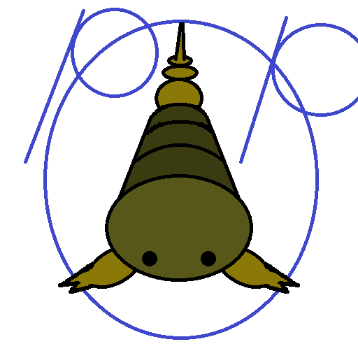

# PteroPilot

**English** | [中文](README.zh-CN.md)



**Manage your game servers with plain language.**
PteroPilot is an open-source MCP server that lets AI assistants like Claude and Cursor directly manage game servers on [Pterodactyl](https://pterodactyl.io) / [Pelican](https://pelican.dev) panels.

> "Check how the survival server is doing, restart it if it's lagging, and see whether the latest backup succeeded."

No panel login, no digging through logs — just ask.

## What it does

- 📊 List servers, live status, and resource usage
- ⚡ Power controls: start / stop / restart / kill
- 🖥️ Console: send commands
- 📁 Files: browse, read, write, upload, rename, delete, create folders, one-time download links
- 💾 Backups: list, create, restore, delete
- 🔒 Safety: read-only mode and explicit confirmation for dangerous actions; your API key never leaves your machine

## Install

Requires Python 3.12+. Run in one line with [`uv`](https://docs.astral.sh/uv/):

```bash
uvx pteropilot
```

## Configure

Add this to your MCP client config (Claude Desktop, Cursor, etc.):

```json
{
  "mcpServers": {
    "pteropilot": {
      "command": "uvx",
      "args": ["pteropilot"],
      "env": {
        "PANEL_URL": "https://panel.example.com",
        "PANEL_API_KEY": "ptlc_xxxxxxxxxxxxxxxxxxxx",
        "PANEL_READONLY": "0"
      }
    }
  }
}
```

| Variable | Description |
|---|---|
| `PANEL_URL` | Your panel URL |
| `PANEL_API_KEY` | Panel API key (Panel → Account → API Credentials) |
| `PANEL_READONLY` | Set to `1` for read-only mode: blocks power, write, and delete actions. Recommended while trying it out |

Then just talk to your AI naturally, for example:

- "List all my servers and their status"
- "When was the latest backup on smp? Create one if missing"
- "Upload this plugin to the creative server and restart it"

## Crash alerts (webhook)

The `pteropilot-alerts` command scans your servers read-only and pushes a
notification to a DingTalk / WeCom (WeChat Work) group-bot webhook when a server
is in an abnormal state (offline / error / suspended) or its recent console log
shows crash signals. Perfect for cron:

```bash
# install
uv tool install pteropilot

# test once
PANEL_URL=https://panel.example.com PANEL_API_KEY=ptlc_xxx \
  pteropilot-alerts --webhook "https://oapi.dingtalk.com/robot/send?access_token=xxx"

# run every 5 minutes
*/5 * * * * PANEL_URL=... PANEL_API_KEY=... pteropilot-alerts \
  --webhook "https://oapi.dingtalk.com/robot/send?access_token=xxx" >> /var/log/pteropilot-alerts.log 2>&1
```

Options: `--min-level error` (only error state), `--token <key>` (WeCom bots
that need a URL key), `--timeout <sec>`, `--no-log-signals` (state-only, faster),
`--cooldown <minutes>` (dedupe: same server + same state is not re-notified
within the cooldown; a state change always alerts immediately — prevents alert
storms when cron runs every few minutes. State is persisted in
`~/.pteropilot/alerts_state.json`),
`--confirm-count <n>` (require N consecutive abnormal detections before
notifying — filters transient flaps; recovery resets the counter).

Email channel (second notifier, can be combined with the webhook):

```bash
pteropilot-alerts \
  --smtp-host smtp.example.com --smtp-user you@x.com --smtp-pass <auth-code> \
  --mail-to ops@x.com            # --smtp-port 587 for STARTTLS (default 465 SSL)
```

Per-server tuning (optional): drop a JSON at `~/.pteropilot/alerts.json` (or pass
`--config <path>`). Precedence: server entry > `default` > CLI options.

```json
{
  "default": { "confirm_count": 2, "cooldown_minutes": 15 },
  "servers": {
    "smp":      { "confirm_count": 3, "cooldown_minutes": 60 },
    "creative": { "min_level": "error", "email": false },
    "auth":     { "webhook": false, "email": true, "mail_to": "oncall@x.com" },
    "preview":  { "webhook_url": "https://oapi.dingtalk.com/robot/send?access_token=bbb" }
  }
}
```

Per-server keys: `confirm_count`, `cooldown_minutes`, `min_level`,
`webhook` (bool), `email` (bool), `webhook_url` (route to another bot),
`mail_to` (route email to another recipient).

Only GET requests are issued; no power/command/write actions are ever triggered.

## Run from source

```bash
git clone https://github.com/telson-dev/pteropilot.git
cd pteropilot
uv sync
uv run pteropilot
```

## Compatibility

Targets both **Pterodactyl v1** and **Pelican**. Every client/application endpoint and payload shape used here has been verified against the Pelican panel source (routes and controllers), so one MCP server drives either panel.

## Status & roadmap

Current release: **v0.2.2** (see [CHANGELOG](CHANGELOG.md)). See [ROADMAP](ROADMAP.md) for what's next. Full setup guide, panel config examples, and troubleshooting in [docs/](docs/README.md).

## Security

- Your API key lives only in your local client config and talks directly to your panel — it never passes through any third-party server
- Set `PANEL_READONLY=1` if you want the AI to be look-but-don't-touch
- Prefer a least-privilege API key for AI use

## Docs

[Quick start, Pterodactyl/Pelican config examples, and FAQ](docs/README.md)

## License

MIT

---

_a [telson](https://telson.dev) project_
