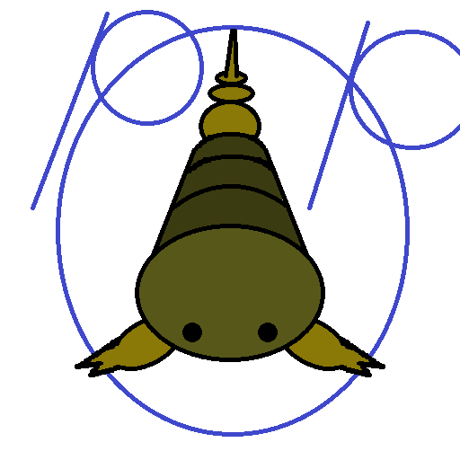

# PteroPilot

[](https://github.com/telson-dev/pteropilot/actions/workflows/ci.yml)
[English](README.md) | **中文**



**用自然语言管你的游戏服务器。**
PteroPilot 是一个开源 MCP server，让 Claude、Cursor 等 AI 助手直接管理 [Pterodactyl](https://pterodactyl.io) / [Pelican](https://pelican.dev) 面板上的游戏服务器。

> 「帮我看看生存服什么状态，卡的话重启一下，顺便看看最近有没有自动备份。」

——不用登录面板，不用翻日志，一句话的事。

## 能做什么

- 📊 查看服务器列表、在线状态、资源占用
- 🌐 网络地址：查看服务器 IP/端口分配（主地址标记）——"我的服务器地址是多少"直接问
- 🗄️ 数据库：查看面板里已分配的数据库主机/库名/用户名（配 LuckPerms 等 MySQL 插件时用）
- 📜 操作审计：谁在何时重启/删文件/建备份（面板事件日志）
- ⏰ 定时任务：查看面板里配置的计划任务（cron、启用状态、上次/下次运行）
- 📊 玩家活跃分析：从日志统计谁最常来、高峰时段、谁还在线
- 👥 子用户权限：谁能管理这台服、各自被授予了哪些权限
- 🗂️ 挂载点：这台服挂了哪些额外存储、是只读还是可写
- ⚡ 电源控制：启动 / 停止 / 重启 / 强杀
- 🖥️ 控制台：发送指令
- 📁 文件管理：浏览、读取、写入、上传、重命名、删除、新建文件夹、一次性下载链接
- 💾 备份：查看、创建、恢复、删除；批量概览与批量创建
- 👥 玩家在线：从控制台日志解析进出（兼容原版/Paper/Spigot/Forge/Fabric 中英文格式）
- 🚨 崩服检测与告警：状态级健康检查、CPU/内存阈值 + 日志级崩溃信号（OOM/JVM/异常退出/致命错误），可配 webhook/邮件通知、冷却去重、连续确认防误报，`~/.pteropilot/alerts.json` 按服务器调灵敏度
- ⚡ 批量操作：一次看全部状态摘要，批量开/停/重启，批量备份概览/创建
- 🔒 安全：只读模式 + 高危操作二次确认，API Key 永不离开本机

## 安装

需要 Python 3.12+。用 [`uv`](https://docs.astral.sh/uv/) 一行跑起来：

```bash
uvx pteropilot
```

### 升级到最新版

`uvx` 会复用缓存，要主动拉最新版：

```bash
uvx --refresh pteropilot      # 或 uvx pteropilot@latest
pip install -U pteropilot     # pip 安装方式
```

**PyPI 版本可能滞后于 GitHub**（发布排队时）。装完先自检：

```bash
pteropilot --version     # 工具数少于 README 里的数量 = 装到了旧版
```

国内装包慢或超时，用镜像：

```bash
pip install pteropilot -i https://pypi.tuna.tsinghua.edu.cn/simple
```

要装到最新版（PyPI 还没同步时），从 [GitHub Releases](https://github.com/telson-dev/pteropilot/releases) 下载 `.whl` 后本地安装：

```bash
pip install pteropilot-<版本>-py3-none-any.whl
```

> 注：GitHub 在国内访问可能不稳定，本项目不提供任何代理方案；若下载困难，优先等 PyPI 同步或用镜像装。

## 配置

在你的 MCP 客户端（Claude Desktop、Cursor 等）配置文件中加入：

```json
{
  "mcpServers": {
    "pteropilot": {
      "command": "uvx",
      "args": ["pteropilot"],
      "env": {
        "PANEL_URL": "https://panel.example.com",   // 面板根地址，别带 /api
        "PANEL_API_KEY": "ptlc_xxxxxxxxxxxxxxxxxxxx",
        "PANEL_READONLY": "0"
      }
    }
  }
}
```

| 环境变量 | 说明 |
|---|---|
| `PANEL_URL` | 你的面板地址 |
| `PANEL_API_KEY` | 面板 API Key（面板 → Account → API Credentials） |
| `PANEL_READONLY` | 设为 `1` 进入只读模式：禁止电源、写入、删除等操作。先试用、还不信任 AI 时建议开启 |

配置好后，直接对 AI 说人话即可，例如：

- 「列出我所有服务器和状态」
- 「smp 服最近一次备份是什么时候？没有就现在建一个」
- 「往 creative 服上传这个插件并重启」

## 连不上面板？先跑自检

```bash
pteropilot --doctor              # 检查 Python/配置/密钥前缀/面板连通/告警渠道
pteropilot --doctor --no-network # 只查配置，不联网
```


## 广播一条指令到所有服务器

```bash
pteropilot --broadcast "say 服务器 5 分钟后重启"      # 只发 running 的服务器
pteropilot --broadcast "whitelist add Steve"        # 普通指令免确认
pteropilot --broadcast "stop" --confirm             # 高危指令必须确认
pteropilot --broadcast "say hi" --servers smp,creative
pteropilot --broadcast "say hi" --json              # 结构化输出，给脚本用
```

适合写进 cron / 计划任务：不用起 MCP 客户端，跑一条就退出。
高危指令（`stop` / `kill` / `op` / `ban` / `whitelist off` 等）不带 `--confirm` 会被拒绝。
退出码：`0` 全部发出、`1` 有失败、`2` 用法错误、`3` 被拦截（只读 / 缺确认）。
`--json` 输出 `{status, command, scope, total, ok, failed, results[]}`，被拦截时带 `reason`（`readonly` / `need_confirm` / `empty_command` / `no_running` / `no_targets`）。

输出**不含任何密钥**（只显示前缀），可以直接整段贴给我排查。会告诉你：
配置是否齐全、地址是否被自动规范化（带 `/api` 会被剥掉）、密钥前缀是否用错
（`ptla_` 应用密钥不能给核心工具用）、面板连通状态与 401/403/404 的具体含义。

## 从命令行发电源信号

```bash
pteropilot --power start   --servers smp,creative      # start 免确认
pteropilot --power restart --servers smp --confirm     # stop/restart/kill 要确认
pteropilot --power stop    --servers "*" --confirm     # "*" = 全部服务器
pteropilot --power restart --servers smp --confirm --json
pteropilot --power restart --servers smp --confirm --at 03:00   # 等到 3 点
pteropilot --broadcast "say 马上回来" --in 5m                    # 等 5 分钟
```

`--in` / `--at` 让进程**等到点再执行**——有些「3 点重启」的需求 cron 表达不了
（比如要等面板里某件事先完成）。等待上限 24 小时（更长的请交给 cron/systemd）；
等待期间 Ctrl+C 会取消并以退出码 `4` 退出，一个字都不会发。

和 `batch_power` 工具走同一份逻辑。`--servers` 必填（电源是写操作，不替你猜范围）。
退出码与 `--broadcast` 一致。

## 不开 AI 也能看状态

```bash
pteropilot --status              # 全部服务器：状态、健康度、CPU、内存
pteropilot --status smp          # 单台，额外读日志推断在线玩家数
pteropilot --status --json       # 结构化输出
```

退出码：全部健康才是 `0`，否则 `1`——可以直接当 cron 健康检查用。
单台查询失败会显示 `⚠`，不会盖住其他服务器。

加上 `--watch` 就会一直跑下去，并且**只在真的变化时重画**（CPU 和内存每秒都在
小幅抖动，刻意排除在变化检测之外，否则它会一直刷屏，反而看不出某台是什么时候
挂的）：

```bash
pteropilot --status --watch                  # 每 30 秒一次，Ctrl+C 退出
pteropilot --status --watch --interval 10    # 间隔 5–3600 秒
pteropilot --status --watch --json           # 变化时每行一个 JSON 对象
```

备份是那种「崩了之后才会想起来」的东西，所以 `--backups` 会在表格里多一列
「最新备份」，并把过期/从未备份的单独列出来（默认阈值 7 天）：

```bash
pteropilot --status --backups                 # 每台最新备份是多久以前
pteropilot --status --backups --backup-days 30
```

定时告警也能替你看，不用自己记得查：

```bash
pteropilot-alerts --webhook https://... --backup-days 7
```

最新成功备份比阈值更旧（或从来没有）的服务器会以 `stale_backup` 状态推送。
如果备份接口本身查询失败，**不告警**——假警报只会让用户把整个告警通道关掉。

三个阈值（`cpu_threshold` / `memory_threshold` / `backup_days`）都能在
`~/.pteropilot/alerts.json` 里按服务器单独覆盖，因为一个全局数字不可能同时
适配「重负载整合包服」和「小大厅服」：

```json
{
  "default": { "cpu_threshold": 85, "memory_threshold": 90, "backup_days": 7 },
  "servers": {
    "heavy-modpack": { "cpu_threshold": 97, "memory_threshold": 98 },
    "tiny-lobby":    { "cpu_threshold": 60, "backup_days": 2 }
  }
}
```

优先级：服务器条目 > `default` 段 > 命令行参数。

算年龄时会跳过失败的备份——恢复不了的备份不算备份。「从未」（没有成功备份）
和「未知」（备份接口查询失败）刻意分开显示，不然用户会误判自己的数据状态。

### 看控制台

服务器崩了、指令没反应，下一步永远是想知道「控制台最后在说什么」。`--log`
直接把它打到终端：

```bash
pteropilot --log smp                       # 末 80 行
pteropilot --log smp --lines 300           # 往前翻（1–2000）
pteropilot --log smp --grep error          # 只匹配行，不区分大小写
pteropilot --log smp --grep Started --json # 机器可读

pteropilot --log "*"                       # 所有可访问服务器一起看
pteropilot --log smp,creative              # 只看这几台
pteropilot --log "*" --grep error --json   # {servers: [...], grep: ...}
```

多台模式并发取（有并发上限，和其他批量工具一致），单台失败会在输出里单独标注、
不盖住其余；没有命中的那台会明说「没有匹配的内容」，而不是悄悄跳过。
`--json` 时多台顶层是 `{"servers": [...], "grep": ...}`，与单台的
`{"server_id": ...}` 区分开，脚本能分辨。

输出前会清掉 ANSI 颜色和回车符，管道或粘贴都不会乱。没有内容可显示时退出码
`1`（空控制台，或 `--grep` 没命中），参数写错是 `2`。

### 玩家历史

玩家活跃度在每次 `list_players` 被调用时记到本机（一次调用一条采样，存在
`~/.pteropilot/playerlog/`）。`--players` 直接读这些文件，**不需要面板配置、
不需要联网**——面板挂了也照样能看：

```bash
pteropilot --players                 # 本机有采样记录的服务器
pteropilot --players smp --days 7    # 近 7 天在线时长排行
pteropilot --players smp --top 5 --json
```

## 装好了先自检版本

```bash
pteropilot --version
# 输出：pteropilot v0.2.33（45 个 MCP 工具）
```

**工具数不对就是版本旧了。** PyPI 上的包可能滞后（最新能力在 GitHub Release 里），
如果 `--version` 显示的工具数明显少于文档里的数量，说明装到了旧版，请从
[GitHub Releases](https://github.com/telson-dev/pteropilot/releases) 下载最新的
`.whl` 安装：`pip install pteropilot-<版本>-py3-none-any.whl`。

## 崩服告警（webhook / 邮件）

`pteropilot-alerts` 命令以只读方式扫描你的服务器，当服务器处于异常态（离线 / 错误 / 挂起）或最近控制台日志出现崩溃信号时，推一条通知到钉钉 / 企业微信机器人 webhook，或发一封邮件。适合配 cron 定时跑：

```bash
# 安装
uv tool install pteropilot

# 试跑一次
PANEL_URL=https://panel.example.com PANEL_API_KEY=ptlc_xxx \
  pteropilot-alerts --webhook "https://oapi.dingtalk.com/robot/send?access_token=***"

# 每 5 分钟跑一次
*/5 * * * * PANEL_URL=... PANEL_API_KEY=... pteropilot-alerts \
  --webhook "https://oapi.dingtalk.com/robot/send?access_token=***" >> /var/log/pteropilot-alerts.log 2>&1

# 先验证通知渠道配没配对（不读服务器、不写状态）
pteropilot-alerts --webhook "..." --test

# 服务器还活着但快撑不住时也通知（不只是挂了才叫）
pteropilot-alerts --webhook "..." --cpu 85 --memory 90

# 卡在冷却期 / 调完灵敏度想重新计数：清空状态
pteropilot-alerts --reset

# 退出码：0=正常；1=参数/配置错误；3=有告警但推送失败（告警没送达，需排查渠道）
```

**Windows 用户**（本机开服 / Windows 云主机）：不用手写 cron，一条命令装好计划任务：

```powershell
# 默认每 5 分钟检查一次，异常推钉钉机器人
powershell -ExecutionPolicy Bypass -File scripts\install_alerts_task.ps1 `
    -Webhook "https://oapi.dingtalk.com/robot/send?access_token=***"

# 每 15 分钟、只报 error 态
... -IntervalMinutes 15 -MinLevel error

# 邮件通道
... -SmtpHost smtp.qq.com -SmtpUser you@qq.com -SmtpPass <授权码> -MailTo ops@x.com

# 查看状态（上次运行 / 结果 / 日志尾部）与卸载
... -Status
... -Remove
```

脚本会自动生成运行包装脚本（把面板凭据也写进去，后台运行不依赖环境变量）、
日志落到 `%USERPROFILE%\.pteropilot\alerts.log`，并支持 `-DryRun` 先看效果。

可选参数：`--min-level error`（只报错误态）、`--token ***`（需要 URL key 的企业微信机器人）、`--timeout <秒>`、`--no-log-signals`（只看状态、不读日志，更快）、`--cooldown <分钟>`（去重：同一服务器同一状态在冷却期内不重复通知；状态一变就立即告警——防止 cron 每几分钟跑一次时的告警风暴）、`--state-file <路径>`（冷却/确认状态持久化位置，默认 `~/.pteropilot/alerts_state.json`）、`--confirm-count <n>`（连续 N 次检测到异常才通知——过滤瞬时抖动；恢复健康归零计数）、`--config <路径>`（按服务器调灵敏度的配置文件，默认 `~/.pteropilot/alerts.json`）、`--dry-run`（演练：只打印"将会通知哪些服务器/走哪些渠道"，不真的发送、不写状态文件——调阈值或开 cron 前先跑一遍）。`--json`（机器可读：把结果（含 errors/channels）以 JSON 输出，便于 cron/监控脚本解析）。`--test`（通道自检：**只验证 webhook/邮件能不能发出去**——发一条测试消息，不读服务器、不写状态；失败会给出常见原因，退出码 1 便于脚本判断。配置告警时先跑这个，别等真崩服才发现没收到）。

邮件通道（第二通知渠道，可与 webhook 同时用）：

```bash
pteropilot-alerts \
  --smtp-host smtp.example.com --smtp-user you@x.com --smtp-pass <授权码> \
  --mail-to ops@x.com            # --smtp-port 587 用 STARTTLS（默认 465 SSL）
  # --mail-from alerts@x.com     # 可选发件人（默认同 --smtp-user）
```

每个参数都有对应环境变量回退，便于把敏感信息移出命令行：

| 环境变量 | 对应参数 | 默认值 |
|---|---|---|
| `WEBHOOK_URL` | `--webhook` | （空） |
| `SMTP_HOST` | `--smtp-host` | （空） |
| `SMTP_PORT` | `--smtp-port` | `465` |
| `SMTP_USER` | `--smtp-user` | （空） |
| `SMTP_PASS` | `--smtp-pass` | （空） |
| `MAIL_TO` | `--mail-to` | （空） |
| `MAIL_FROM` | `--mail-from` | （空） |
| `CONFIRM_COUNT` | `--confirm-count` | `1` |

按服务器调灵敏度（可选）：把 JSON 放到 `~/.pteropilot/alerts.json`（或传 `--config <路径>`）。优先级：服务器条目 > `default` > 命令行参数。

```json
{
  "default": { "confirm_count": 2, "cooldown_minutes": 15 },
  "servers": {
    "smp":      { "confirm_count": 3, "cooldown_minutes": 60 },
    "creative": { "min_level": "error", "email": false },
    "auth":     { "webhook": false, "email": true, "mail_to": "oncall@x.com" },
    "preview":  { "webhook_url": "https://oapi.dingtalk.com/robot/send?access_token=***" }
  }
}
```

只发 GET 请求；绝不触发电源 / 指令 / 写操作。

## 从源码运行（开发者）

```bash
git clone https://github.com/telson-dev/pteropilot.git
cd pteropilot
uv sync
uv run pteropilot
```

## 兼容性

同时支持 **Pterodactyl v1** 与 **Pelican**。所用 client / application API 端点及 payload 形状均已对照 Pelican 面板源码（routes 与 controllers）核实，一个 MCP server 两个面板通用。

## 状态与路线图

当前发布版：**v0.2.33**（见 [CHANGELOG](CHANGELOG.md)）。下一步计划见 [ROADMAP](ROADMAP.md)；完整安装指南、两款面板配置示例与 FAQ 见 [docs/](docs/README.md)。

## 安全说明

- API Key 只保存在你本机的客户端配置中，仅用于直接请求你的面板，不经过任何第三方服务器
- 不放心就开 `PANEL_READONLY=1`，AI 只能看不能动
- 建议给 AI 使用权限最小化的 API Key

## 文档

[快速上手、Pterodactyl/Pelican 配置示例、FAQ](docs/README.md)

## 许可

MIT

---

_a [telson](https://telson.dev) project_
